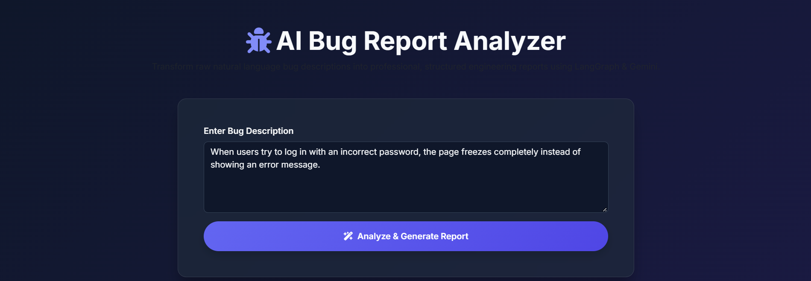
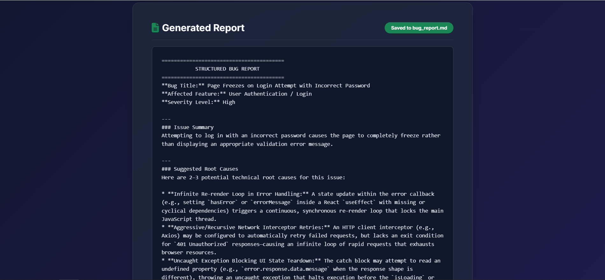

<div align="center">

# 🐛 AI Bug Report Analyzer

> **Transform raw, natural language bug descriptions into professional, structured engineering reports instantly using LangGraph, Google Gemini, and FastAPI.**

[](https://www.python.org/)
[](https://fastapi.tiangolo.com/)
[](https://langchain-ai.github.io/langgraph/)
[](https://getbootstrap.com/)

</div>

---

## 🚀 Overview

Debugging and writing standardized bug reports can be tedious and time-consuming for engineering teams. **AI Bug Report Analyzer** is an intelligent, full-stack workflow automation tool designed to bridge the gap between non-technical bug descriptions and developer-ready specifications. 

Using a multi-node **LangGraph** orchestration pipeline powered by **Google Gemini AI**, the application analyzes raw problem descriptions, classifies severity levels, diagnoses technical root causes, and formats clean, markdown-ready reports with a single click.

---

## 🖼️ Application Preview

### 1. Modern Glassmorphism Web Interface (Input View)
*Users can easily input raw problem statements or error descriptions into a clean, distraction-free environment.*
<div align="center">
  
</div>

### 2. Structured Analysis & Report Generation (Output View)
*The AI breaks down the issue into actionable engineering insights, determining titles, affected modules, severity, and potential root causes—automatically exporting to Markdown.*
<div align="center">
  
</div>

---

## 🛠️ Key Features

* **Multi-Node LangGraph Pipeline:** Decoupled architecture separating bug analysis, severity detection, root cause generation, and final report compilation into sequential state nodes.
* **Google Gemini Integration:** Leverages cutting-edge LLMs (`gemini-3.8-flash`) via `langchain-google-genai` for precise technical reasoning.
* **Full-Stack Implementation:** Built on a robust **FastAPI** backend supporting asynchronous processing and a modern dark-themed **Bootstrap 5** frontend with glassmorphic styling.
* **Automated Markdown Export:** Automatically saves generated engineering specifications into a persistent `bug_report.md` file in the project directory.
* **Robust Error Handling & Fallbacks:** Custom content extraction utilities designed to gracefully parse complex or structured LLM payloads.

---

## ⚙️ Project Architecture & Workflow

The application executes a state-driven graph sequence (`BugReportState`):
1. **Node 1 (`bug_analysis`):** Extracts descriptive bug titles, affected application modules, and concise summaries.
2. **Node 2 (`severity_detection`):** Classifies the priority level (`Critical`, `High`, `Medium`, `Low`).
3. **Node 3 (`root_cause_suggestion`):** Formulates brief, actionable technical hypotheses or root causes.
4. **Node 4 (`format_report`):** Compiles all parameters into an official template and logs the markdown file.

---

## 📁 Project Directory Structure

```text
ai-bug-analyzer/
│
├── templates/
│   └── index.html          # Frontend UI (Bootstrap 5 + Glassmorphism)
├── venv/                   # Python Virtual Environment
├── .env                    # Environment variables (Google API Key)
├── main.py                 # FastAPI backend & LangGraph workflow logic
├── requirements.txt        # Project dependencies list
├── bug_report.md           # Auto-generated markdown report output
├── Capture1.PNG            # UI Screenshot (Input interface)
└── Capture2.PNG            # UI Screenshot (Generated output)
